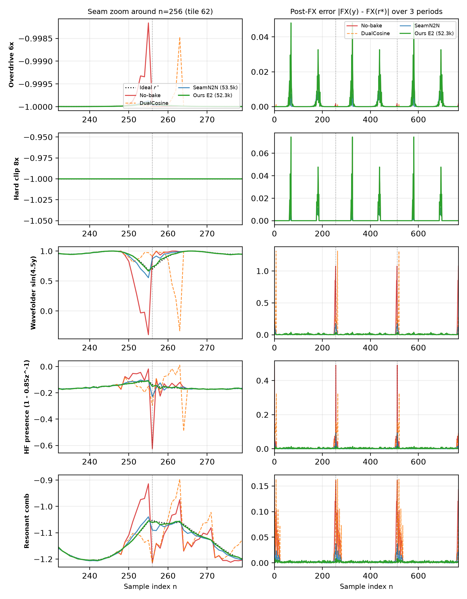

# Experiments required by the aiXiv v2.0 review (and claims in v2.1)

| ID | Experiment | Why (review item) | Compute | Status |
|---|---|---|---|---|
| S1 | Paired stats on existing 5-seed holdout + 20 boards | W4 stats | CPU, seconds | DONE (`scripts/stats_paired_holdout.py`) |
| S2 | Extend holdout to 10 seeds (hybrid, N2N, DualCosine, no-bake) | W4: n=5 cannot reach p<0.05 | engine RTX 3060 | DONE (`results/e1_holdout_10seed.json`) |
| S3 | Pareto front + champion-selection rule export over the 5k campaign | W5 | CPU, <1 h | DONE (`results/e5_pareto_export.json`) |
| S4 | Multi-search-seed replication of v14 hybrid converge (3 search seeds) | provisional N2N-gate claim | GPU | DONE (`results/e2_v14_converge_multiseed.json`) |
| S5 | Listening study (MUSHRA, ≥15 listeners) | Nlisteners=0 ceiling | human time | Julian decision |

## Follow-up paper idea (post-v14)

- **FX-aware / seam-derivative FitCell loss:** While `R_blend` already preserves a 1.9–2.5× post-FX Edge RMSE advantage over `SeamN2N` across five downstream effects (`results/fx_suite_10seed.json`), nonlinear wavefolding (`sin(4.5y)`) still amplifies dry seam error by ~2.7–2.8× and high-pass presence filtering (`1 - 0.85z^-1`) penalizes slope jumps (`R_seam = 0.960`).
- **Next paper direction:** Add a seam-derivative / high-pass penalty (`|Δy - Δr*|` at the wrap) and random differentiable FX augmentation (wavefolder, asymmetric overdrive, HF shelf) inside the `FitCell` inner loss, paired with a formal MUSHRA listening study (`S5`) under real synthesis FX chains.

